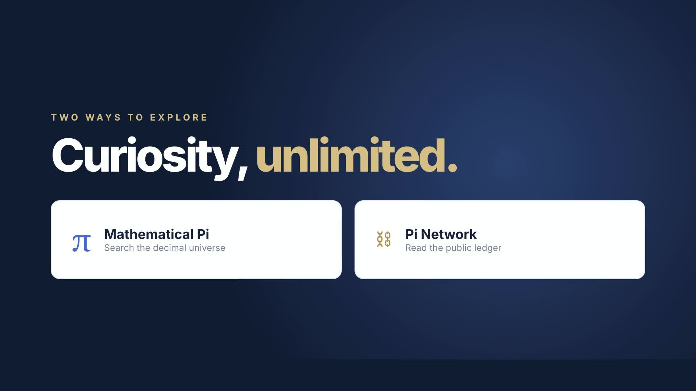

# OmniPi

**Live app:** [Open OmniPi](https://nazeeh111.github.io/omnipi/)

OmniPi is an independent, read-only web explorer for two different meanings of Pi:

- **π:** search the first 1,000,000 decimal digits by sequence, English word (phone keypad encoding), or one-based position. The dataset is bundled and searched locally.
- **Pi Network:** browse recent ledgers, transactions, payments, and operations from the public Horizon API; page through activity; switch between Mainnet and Testnet; and look up public accounts, transaction hashes, and ledger numbers with related records.

The modes are separate on purpose. Mathematical π and the Pi Network blockchain are unrelated systems that share a symbol. OmniPi makes that distinction clear while giving curious people one place to explore both.

## Watch OmniPi in 21 seconds

[](brag.mp4)

[Play or download the launch film](brag.mp4). The film shows a representative digit search and a Mainnet ledger snapshot recorded on October 22, 2026; live records change continually.

[Film source and original soundtrack generator](video-source/README.md) are included for reuse.

## Run locally

Requires Node.js 18 or newer. No package installation or API key is needed.

```sh
npm start
```

Open `http://127.0.0.1:4173`. If that port is busy, run `PORT=4174 npm start`.

Run focused checks with `npm test`. Regenerate the independent 100,000-digit comparison file with `python3 scripts/generate_pi.py` (Python 3.11 or newer).

## Publish as static files

The site needs no build step. Serve `index.html`, `styles.css`, `main.js`, `lib.js`, `favicon.svg`, and `data/pi-1000000.txt` at the repository root. Any static host that serves JavaScript modules works, including GitHub Pages. The included Node server is only for local development.

The Pi Network view makes browser requests directly to `https://api.mainnet.minepi.com` or `https://api.testnet.minepi.com`. If those services or cross-origin access are unavailable, the page reports the error and the mathematical π mode continues to work. The app never asks for a wallet connection or secret key. It sends a public account, hash, or ledger number to the selected public Horizon endpoint only when you look it up.

## Scope and provenance

- The million-digit file comes from [TidyTuesday's Pi dataset](https://github.com/rfordatascience/tidytuesday/tree/main/data/2026/2026-03-24). We checked its row positions, digit characters, length, and first 100,000 digits against an independent Chudnovsky calculation. It covers exactly 1,000,000 digits **after** the decimal point; an absent sequence might occur later. See [DATA_SOURCE.md](DATA_SOURCE.md).
- Word search supports English A–Z and converts letters to digits on a telephone keypad. It does not search literal text in π.
- Blockchain data is live and read only. It is not a financial service, wallet, trading tool, or independently operated node. A live endpoint may return incomplete or delayed data.
- OmniPi is an independent implementation and is not affiliated with the Pi Network Core Team.

## License

MIT. See [LICENSE](LICENSE).
